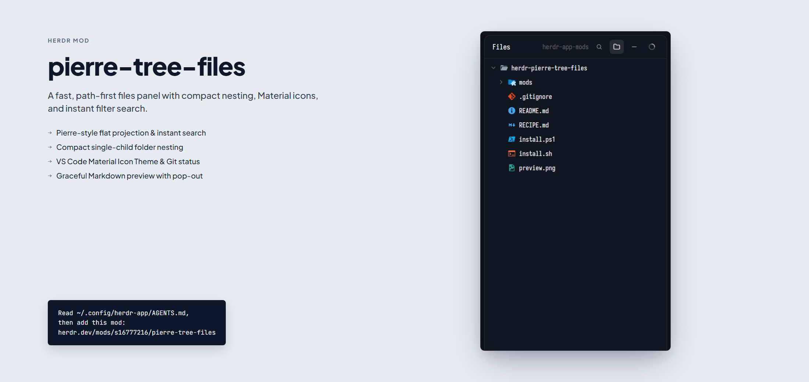

# Pierre Tree Files (Herdr Mod)

A fast, modern file explorer panel for [Herdr App](https://github.com/herdr-app), built with a **Pierre-style Path-First tree architecture**, **VS Code Material Icon Theme**, **compact folder nesting**, **instant search filter**, and **Git status indicators**.



## ✨ Features

- **🌲 Pierre-Style Path-First Projection**:
  - Linear tree projection with flat hierarchy arrays.
  - O(1) canonical path lookups without recursive DOM/element reconstruction.
- **📁 Compact Folder Nesting**:
  - Automatically collapses single-child directory hierarchies (e.g., `src/components/ui/` in a single line).
  - One-click toggle in the header toolbar to turn on/off.
- **🔍 Instant Search & Filter**:
  - Press `Ctrl+F` (or `Cmd+F`) to instantly reveal the filter input and start typing.
  - Real-time substring and path filtering with match count badges.
  - Hit `Esc` to instantly clear and return to the full tree.
- **🎨 Material Icon Theme**:
  - Complete Material Icon Theme mapping for file names, extensions, and folder names.
  - Automatically adapts to Herdr's light and dark themes.
- **🌿 Git Status Integration**:
  - Shows file change indicators: `A` (Added), `M` (Modified), `D` (Deleted), `U` (Untracked).
  - Folder badges indicate the number of modified descendant files inside collapsed trees.
- **📝 Graceful Markdown Integration**:
  - If `markdown-panel` is installed: provides rich block rendering, inline section editing, and popout `↗` (`Ctrl+Shift+M`).
  - If `markdown-panel` is not installed: gracefully degrades to syntax-highlighted code editor preview without errors.

---

## 🚀 Installation

### Option 1: One-Click Script

#### Windows (PowerShell)
```powershell
git clone https://github.com/s16777216/herdr-pierre-tree-files.git
cd herdr-pierre-tree-files
.\install.ps1
```

#### macOS / Linux (Bash)
```bash
git clone https://github.com/s16777216/herdr-pierre-tree-files.git
cd herdr-pierre-tree-files
./install.sh
```

### Option 2: Manual Installation

Copy the `mods/pierre-tree-files` directory into your Herdr configuration folder:
- **Windows**: `%USERPROFILE%\.config\herdr-app\mods\pierre-tree-files`
- **macOS / Linux**: `~/.config/herdr-app/mods/pierre-tree-files`

Then verify the mod:
```bash
herdr-app check ~/.config/herdr-app/mods/pierre-tree-files
```

---

## 🛠 Enabling in Your Layout

In your Herdr layout file (e.g. `~/.config/herdr-app/layouts/main.json` or your custom layout), set the mod name of the file panel block to `"pierre-tree-files"`:

```json
{
  "id": "files",
  "type": "block",
  "content": {
    "mod": "pierre-tree-files"
  }
}
```

Herdr will hot-reload within a second!

---

## ⌨️ Keyboard Shortcuts

| Shortcut | Description |
|---|---|
| `Ctrl+F` / `Cmd+F` | Open instant search filter and focus input |
| `Esc` | Close search / Exit block edit / Return from file preview to tree |
| `Ctrl+Shift+M` / `Cmd+Shift+M` | Open current Markdown file in floating window |

---

## 📄 License

MIT License. Material Icon Theme assets are used under their respective open-source licenses.
