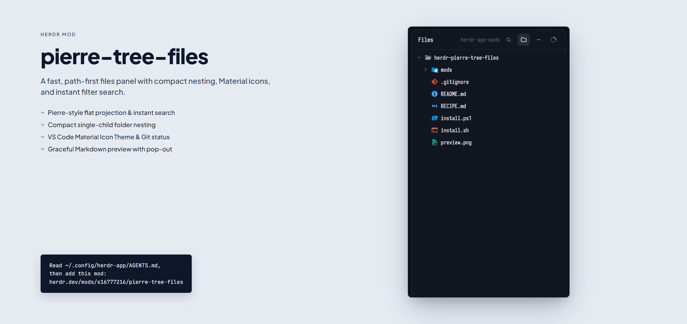

# Pierre Tree Files

A fast, modern file explorer, code editor, and image viewer suite for Herdr App powered by a Pierre-style path-first tree projection, VS Code's Material Icon Theme, compact single-child folder nesting (`src/components/ui`), instant fuzzy/substring search with live count, Git change status markers, standalone editor tabs (`pierre-tree-files-editor`), and Material-iconed tab pills (`pierre-tree-files-tab`).

## What you see

1. **`pierre-tree-files` (Sidebar File Explorer)** — Sits in a layout block (typically the right sidebar, min 200px, max 600px) as a flush card (`border_l(1)`, no `rounded(10)`) on `theme().background`:
   - **Header** (42px high, px 14, gap 6, bottom border): "Files" title, workspace folder name, and toolbar icon buttons (Search `Ctrl+F`, Compact folders toggle, Collapse all, Refresh).
   - **Instant Search Bar** (34px high, `theme().raised`, shown when searching): 13px search icon, 26px text input (`"Filter files… (Esc to close)"`), `"N found"` count pill, and close button.
   - **File Tree View** (flex-1, scrollbar enabled, p 4): 26px rows with hierarchical indentation (`6 + depth * 14px`), 12px chevron, 15px Material icon, truncated name, hover split-right icon (`panel-right`), active-file highlight (`bg(t.selected)`), and Git status markers (`A` green, `M` yellow, `D`/`U` red, plus folder change count badge). Expanding an uncached folder immediately replaces its chevron with a spinning `.spin(900)` icon and inserts an indented `Loading…` row underneath until entries load.

2. **`pierre-tree-files-editor` (Standalone Tab / Split Pane Editor, Markdown Preview & Image Viewer)** — Opens via `tab.new` or `pane.split`, registering its normalized file path per pane in `shared("pierre-tree-files.open_files")`:
   - **Breadcrumb Bar** (26px high, px 10, bottom border): VS Code style parent path segments separated by `›`, semibold file name, and a 6px yellow dot when dirty.
   - **Markdown Preview Mode** (`.md`, `.markdown`, `.mdx`): Defaults to `Preview` (`TextView.markdown`) with a right-aligned `Preview | Source` toggle and clickable web/relative-file links.
   - **Text/Code Mode**: Right-aligned pure SVG icon buttons (Revert `undo.svg` when dirty, Save `save.svg`), plus a full-bleed `Editor` with syntax highlighting, line numbers, and code folding.
   - **Image Viewer Mode** (`.png`, `.jpg`, `.jpeg`, `.gif`, `.webp`, `.ico`, `.bmp`, `.svg`): Shows natural dimensions (`W×H`) next to the file name and zoom controls (`−`, `Fit` / `%` toggle, `+`) on the right. Defaults to Fit-to-Window scaling (`max_w_full().max_h_full()`), switching to scrollable pixel-scaled view when zoomed.

3. **`pierre-tree-files-tab` (Tab Bar with File Icons)** — Optional custom tab bar replacing `tabs`:
   - Displays 14px Material file icons alongside file names on editor tabs, automatically matching Herdr's light and dark themes.
   - Disables double-click `tab.rename` on `isEditorTab` tabs and shows a tailored right-click menu (`New tab`, `Close`, omitting `Rename`).
   - Labels the right-side changes toggle button `Git`.

## How it behaves

- **Folder clicks**: Toggles expanded/collapsed state. Uncached folders show an immediate spinning indicator and `Loading…` placeholder row while PowerShell/shell directory listing runs.
- **File clicks & Deduplication**: Clicking a file runs `openOrFocusFile`: if an active-space editor pane already has that file open in `shared("pierre-tree-files.open_files")`, it switches to that tab and pane (`tab.select` + `pane.focus`); otherwise it opens a new `pierre-tree-files-editor` tab via `tab.new`. The file tree highlights whichever file belongs to the focused editor pane.
- **Split-in-Current-Tab Opening**: `Ctrl+Click` / `Cmd+Click` / `Alt+Click` on a file row, clicking the hover `panel-right` icon button, or choosing `向右分割開啟` / `向下分割開啟` in the right-click menu calls `splitOrFocusFile`, splitting the active tab (`pane.split`) with `pierre-tree-files-editor`—or focusing the existing split pane if that file is already open inside the active tab.
- **Context Menu (`pierre-tree-files-menu`)**: Right-clicking a file, folder, or empty space in `files-tree` opens a popup menu for opening/splitting, copying absolute or relative path, revealing in Explorer (`explorer.exe` with `["/select,", path]`), opening a terminal in folder, creating new files/folders, renaming, and deleting.
- **Workspace CWD preservation**: When focusing on a pure-mod editor tab (which has no terminal CWD), `pierre-tree-files` falls back to sibling terminal panes in the same space and a per-space `lastCwdBySpace` cache so the sidebar tree stays anchored to the active project.
- **Saving**: `Ctrl+S` / `Cmd+S` (bound via `cx.bind_keys` + `.key_context("CodeEditor")` + `.on_action`) or clicking the save SVG button performs an atomic `writeTextFile` check against `cleanText`.
- **Image caching & zooming**: External project images are copied idempotently into `~/.config/herdr-app/data/image-cache/` via PowerShell `Copy-Item` (Windows) or `cp` (Unix) so GPUI's sandboxed `image()` loader can render them without triggering mod hot-reloads. Supports `+`/`-` zoom steps (25%–400%) and `0` to reset to Fit.
- **Folder Watching**: Watches the active workspace root via `watchFolder` and refreshes on file system events.

## Built from

- **GPUI Elements**: `v_flex`, `h_flex`, `div`, `svg`, `image`, `Editor`, `EditorState`, `Input`, `InputState`.
- **Herdr APIs**: `spaces`, `panes`, `focused`, `layout`, `exec`, `readTextFile`, `writeTextFile`, `watchFolder`, `theme`, `settings`, `window`, `run`, `notify`, `appHome`.
- **Pure Models**: `tree.js` (`PierreTreeModel`), `icons.js` (Material Icon Theme resolution table).
- **Art**: VS Code Material Icon Theme SVG glyphs in `mods/pierre-tree-files/icons/`, editor action SVGs in `mods/pierre-tree-files-editor/icons/`, and window controls in `mods/pierre-tree-files-tab/`.

## Watch out

- **Sandboxing**: Herdr prevents cross-mod JS imports; `pierre-tree-files-tab` bundles its own local `icons.js` and references `mods/pierre-tree-files/icons/` for SVG assets.
- **Editor Keybindings**: `Editor` consumes `on_key_down` events when focused; `Ctrl+S` / `Cmd+S` must be registered with `cx.bind_keys` and `.key_context("CodeEditor")` + `.on_action`.
- **Image Sandbox & Hot-Reload Loop**: GPUI `image()` only loads paths relative to `~/.config/herdr-app/`. Caching images inside `mods/` triggers infinite hot-reload loops, so external images must be cached idempotently in `data/image-cache/` (using PowerShell `Copy-Item -LiteralPath` on Windows to avoid `cmd.exe` quote-escaping bugs).
- **Windows Path Separators**: Paths in the Pierre projection are normalized to forward slashes before indexing.

## Done when

1. `herdr-app check` passes with exit code 0 for all four mods (`pierre-tree-files`, `pierre-tree-files-editor`, `pierre-tree-files-menu`, `pierre-tree-files-tab`).
2. Clicking an uncached folder immediately shows a spinning loader and `Loading…` row before rendering children.
3. Clicking a file checks `shared("pierre-tree-files.open_files")`: opens a `pierre-tree-files-editor` tab on first open, focuses the existing tab/pane on repeat clicks without duplicates, and highlights the open file row in `pierre-tree-files`; `Ctrl+Click` / hover `panel-right` icon / right-click `向右分割開啟`・`向下分割開啟` splits inside the active tab without duplicating already-open splits.
4. Editor tabs in `pierre-tree-files-tab` ignore double-click rename and omit `Rename` from their right-click menu (`New tab`, `Close`), while the changes panel button is labeled `Git`.
5. Opening `.md`/`.markdown`/`.mdx` defaults to `Preview` (`TextView.markdown`) with a `Preview | Source` toggle and clickable links; editing and pressing `Ctrl+S` / `Cmd+S` saves atomically and clears the dirty indicator dot.
6. Right-clicking any file, folder, or empty space in `pierre-tree-files` opens `pierre-tree-files-menu` (open, split right/down, copy path/relative path, reveal in Explorer, open terminal here, new file/folder, rename, delete).
7. Clicking an image opens it cleanly in Fit mode without flashing, and `+`/`-`/`0` zoom controls work smoothly.
