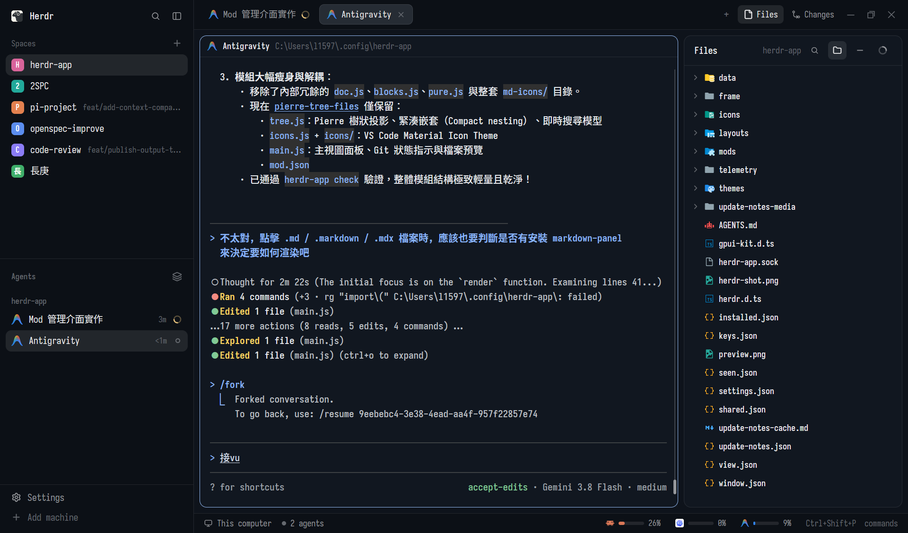

# Pierre Tree Files

A fast, modern files panel for Herdr App powered by a Pierre-style path-first tree projection, VS Code's Material Icon Theme, compact single-child folder nesting (`src/components/ui`), instant fuzzy/substring search with live count, Git change status markers, bounded syntax-highlighted previews, and graceful Markdown integration with `markdown-panel`.

## What you see

The mod sits in a layout block (typically the sidebar or side stack, min 200px, max 600px). It renders as a rounded-10 bordered card on `theme().background` with `theme().border` (1px) and `theme().foreground` (13px type). Top to bottom:

1. **Header** (42px high, px 14, gap 6, bottom border in `theme().border`):
   - When viewing a file preview: a 20px "←" back button on the left (muted, foreground on hover).
   - "Files" title (13px semibold).
   - Trailing breadcrumb/info (12px `theme().dim`): when viewing a file, shows the file icon (14px) and file name/relative path; when viewing the tree, shows current repository/workspace folder name.
   - **Toolbar icon buttons** (26×26px, rounded 6, 13px SVG glyphs, hover `theme().hover`):
     - **Search** (glyph `search`): toggles the instant search filter bar (`Ctrl+F` / `Cmd+F`). Highlighted with `theme().selected` when active.
     - **Compact nesting** (glyph `folder`): toggles compact single-child folder chaining (`On` / `Off`). Highlighted when active.
     - **Collapse all** (glyph `minus`): collapses all open folders at once.
     - **Refresh** (glyph `spinner`): forces a full folder re-scan and git status check.
   - When a Markdown file is open and `markdown-panel` is installed:
     - Formatted / Source toggle button (24px high, px 9, rounded 6, 12px font medium).
     - Refresh button (13px icon).
     - Pop-out window button `↗` (24px high, px 7, rounded 6, raised background, border 1).

2. **Instant Search Input Bar** (shown only when searching, 34px high, px 10 py 4 gap 6, `theme().raised` background, bottom border):
   - 13px search icon in `theme().dim`.
   - 26px high text input box with placeholder `"Filter files… (Esc to close)"`.
   - Result badge: `"N found"` in `theme().surface` pill (11px, `theme().dim`).
   - Close button (`×` icon, 22×22px, rounded 4, Esc shortcut).

3. **File Tree View** (flex-1, scrollbar enabled, p 4):
   - Each row is 26px high, rounded 6, with hierarchical indentation (`6 + depth * 14px`).
   - Folder row: 12px chevron (`chevron-down` or `chevron-right`), 15px Material folder icon, folder name (or compact chained name like `components/ui`), and badge count in `theme().ansi3` if child files have Git modifications.
   - File row: 12px spacer, 15px Material file icon resolved by extension/filename/light-dark theme, truncated file name.
   - Git indicators on the right (11px semibold): `A` (green `ansi2`), `M` (yellow `ansi3`), `D` (red `ansi1`), `U` (red `ansi1`).
   - Empty/Filter states: clean centered message with "Clear filter" action.

4. **File Preview View** (shown when a file is clicked):
   - **Markdown file** (`.md`, `.markdown`, `.mdx`):
     - If `markdown-panel` is installed: rich block-rendered Markdown with YAML frontmatter highlighting, interactive tables, and inline editing.
     - If `markdown-panel` is not installed: clean syntax-highlighted code editor view with Markdown lexing.
   - **Code/Text files**: syntax-highlighted read-only editor view via `EditorState` (truncated gracefully above 400KB).

## How it behaves

- **Folder clicks**: clicking a folder row toggles expanded/collapsed state. If compact nesting is enabled and a folder has exactly one subfolder, clicking expands or collapses the entire compact chain together.
- **File clicks**: clicking a file switches the view to preview mode, loads content via `readTextFile`, and announces `shared("markdown-panel.target")`.
- **Search filtering**: typing in the search bar updates the tree projection instantly (canonical path substring matching). Folder rows matching any descendants remain visible and expanded. Pressing `Escape` closes the search bar and clears the filter.
- **Escape navigation**:
  - If search bar is open: closes search and clears query.
  - If in Markdown block editing: closes active block editor.
  - If previewing a file: returns to the tree view.
- **Keyboard shortcuts**:
  - `Ctrl+F` / `Cmd+F`: opens the search filter and focuses the input.
  - `Ctrl+Shift+M` / `Cmd+Shift+M`: pops out the current Markdown file into a floating window.
  - `Escape`: dismisses the current context hierarchically.
- **Folder Watching**: automatically watches the active workspace root via `watchFolder` and refreshes on file system events.

## Built from

- **GPUI Elements**: `v_flex`, `h_flex`, `div`, `svg`, `image`, `Editor`, `EditorState`, `Input`, `InputState`.
- **Herdr APIs**: `spaces`, `panes`, `focused`, `layout`, `exec`, `readTextFile`, `watchFolder`, `theme`, `settings`, `window`, `openOverlay`, `setShared`, `home`.
- **Pure Models**: `tree.js` (`PierreTreeModel`), `icons.js` (Material Icon Theme resolution table).
- **Art**: VS Code Material Icon Theme SVG glyphs in `icons/`, Lucide chevrons.

## Watch out

- **Sandboxing**: Herdr prevents cross-mod JS imports. Optional features (like `markdown-panel` rich view) must be detected via filesystem checks (`readTextFile(home() + "/.config/herdr-app/mods/markdown-panel/mod.json")`) rather than dynamic imports across directories.
- **Windows Path Separators**: Git returns forward slashes, PowerShell/Windows returns backslashes. Paths in the Pierre projection are normalized to forward slashes before indexing.
- **Mouse Down Event Propagation**: Interactive buttons must call `.on_mouse_down("left", (_e, cx) => cx.stop_propagation())` to prevent parent window-drag delay.

## Done when

1. `herdr-app check mods/pierre-tree-files` exits with code 0.
2. Clicking folders expands and collapses hierarchies, including multi-tier compact chains like `src/components/ui`.
3. Clicking the search button immediately focuses the filter input without delay.
4. Typing in the search input filters tree rows in real time and shows accurate match counts.
5. Clicking a `.md` file renders rich Markdown if `markdown-panel` is installed, and gracefully falls back to highlighted code text if not.
6. Clicking "←" or pressing `Esc` returns cleanly from file preview to the file tree.
